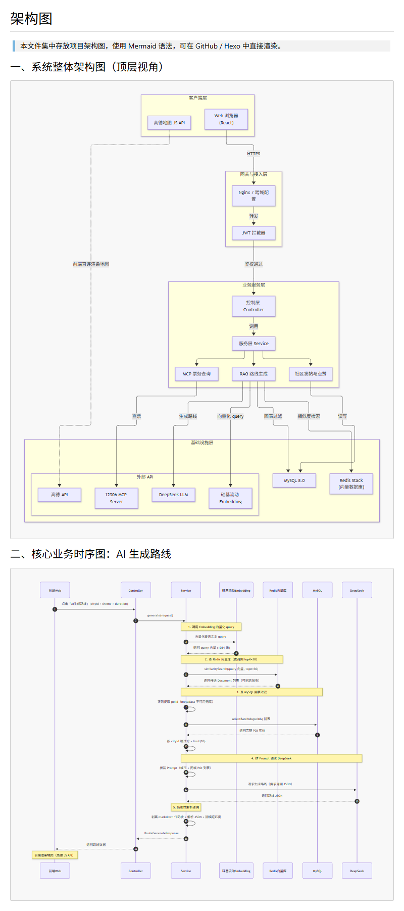

markdown
# Citywalk - AI 旅行规划平台（后端）


基于 Spring Boot + Spring AI 的 Citywalk 规划平台。
用户从 3D 地球选城市，进城市详情页看景点，到工作台拼计划，
AI 优化路线，保存后查票，出发前社区看真实反馈。

## 线上地址

- 前端：https://jazzy-sunflower-21226c.netlify.app
- 后端：已部署至阿里云，如需体验请联系作者提供测试环境地址。

## 系统架构设计

> 包含整体架构图与核心业务时序图（RAG 生成路线）



## 技术栈

**后端**
- Spring Boot 3.3.5 + Java 17
- Spring AI 1.0.0-M6（OpenAI starter + Redis store）
- MyBatis-Plus 3.5.7
- MySQL 8.0
- Redis Stack（RediSearch 向量检索）
- Knife4j 4.5.0（接口文档）
- jjwt 0.12.5 + BCrypt（认证）

**前端**
- React + Vite + Tailwind
- react-globe.gl（3D 地球）
- 高德 JS API（2D 地图）
- dnd-kit（拖拽）
- react-router-dom

**外部服务**
- 高德地图 API（POI 数据 + 公交路径）
- 硅基流动（Embedding，BAAI/bge-m3）
- DeepSeek（LLM，deepseek-chat）
- MCP Server 12306（火车票查询）

## 核心功能

### 已实现

- ✅ 城市列表 + 城市详情
- ✅ 官方路线列表 + 路线详情
- ✅ AI 路线生成（RAG 检索 + DeepSeek 编排）
- ✅ TSP 路线优化（Haversine + 暴力/贪心）
- ✅ 12306 票价查询（MCP 协议接入）
- ✅ 车次绑定到计划（route_ticket 表）
- ✅ 节点间交通摘要（高德 transit + 跳高德导航）
- ✅ 用户系统（注册、登录、JWT 拦截器）
- ✅ 路线保存 + 我的计划
- ✅ 社区（帖子、点赞、评论、图片上传、POI 联动）
- ✅ 个人中心（我的计划、收藏、发布）
- ✅ 打印页（存到手机 / 分享）
- ✅ Swagger/Knife4j 接口文档
- ✅ 后端部署

### 待实现

- [ ] 多天计划（route 表 day_index / trip_id 已预留）
- [ ] Redis 两级缓存（12306 车次 + 余票）
- [ ] AI 接口限流（Redis 令牌桶）
- [ ] SSE 流式返回

## 快速开始

### 环境要求

- JDK 17
- Maven 3.8+
- MySQL 8.x
- Docker Desktop（Redis Stack + MCP Server 12306）

### 依赖的外部服务

| 服务 | 用途 | 获取方式 |
|------|------|----------|
| 高德开放平台 | POI + 公交 | 免费申请 Web 服务 Key |
| 硅基流动 | Embedding | 免费注册，模型 BAAI/bge-m3 |
| DeepSeek | LLM | 充值 20 元够开发 |
| MCP Server 12306 | 火车票 | Docker 一键部署 |

### 启动步骤

1. 启动 Redis Stack：

```bash
docker run -d --name redis-citywalk -p 6379:6379 redis/redis-stack-server:7.2.0-v6
```

2. 启动 MCP Server 12306：

```bash
docker run -d -p 8000:8000 --name mcp-12306 drfccv/mcp-server-12306:latest
```

3. 初始化数据库（详细顺序见 docs/DEPLOYMENT.md）：

```bash
mysql -u root -p < docs/database.sql
mysql -u root -p citywalk < docs/community.sql
mysql -u root -p citywalk < docs/migration-create-all-missing-tables.sql
```

4. 配置 application.yaml：填入 MySQL、高德、硅基流动、DeepSeek、JWT secret。

5. 启动：

```bash
mvn spring-boot:run
```

接口文档：http://localhost:8080/doc.html

项目结构
text
src/main/java/com/citywalk/backend/
├── controller/
│   ├── AuthController
│   ├── CityController
│   ├── PoiController
│   ├── PostController       # 社区
│   ├── RagController
│   ├── RouteController
│   ├── TrainController
│   └── UploadController     # 图片上传
├── service/impl/
├── mapper/
├── entity/
├── dto/
├── config/
│   ├── AmapConfig
│   ├── EmbeddingConfig
│   ├── JwtInterceptor
│   ├── WebMvcConfig
│   └── Knife4jConfig
└── util/
    ├── AmapPoiFetcher
    ├── JwtUtil
    └── UserContext
核心技术点
1. RAG 检索链路
text
用户输入："苏州 出片 半天"
    ↓
查询向量化（硅基流动 BAAI/bge-m3）
    ↓
Redis Stack 向量检索 → Top 10 POI
    ↓
从 text 正则提取 poiId
    ↓
回 MySQL 取完整 POI
    ↓
DeepSeek 编排生成路线
    ↓
返回结构化 JSON
踩过的坑：

Redis VectorStore 只能用 database 0（RediSearch 硬限制）

Spring AI 1.0.0-M6 检索不返回 metadata → text 加 poiId: 前缀 + 正则提取

OpenAiEmbeddingModel 必须传 options

2. TSP 路线优化
距离用 Haversine 公式

节点 ≤ 6：暴力全排列

节点 > 6：贪心最近邻

固定首节点：用户一般从酒店 / 车站出发

3. MCP 票务（12306）
MCP 不是普通 REST，是 JSON-RPC 2.0 + SSE

流程：initialize 拿 session → tools/call → 解析 SSE

坑：RestTemplate 默认 ISO-8859-1 → 用 byte[] 手动解码

4. 幂等保存
查「同 user + 同 city + status=saved + 同 title」

存在返回旧 id，不存在插入

@Transactional 保证原子性

5. 社区
三张表：post / post_like / post_comment

图片上传：MultipartFile → 指定目录 → 静态映射 /uploads/**

POI 联动：抽屉「查看全部反馈」→ /community?poiId=xxx

接口清单
认证

POST /api/auth/register

POST /api/auth/login

城市

GET /api/city/list

GET /api/city/{id}/overview

GET /api/city/{id}/routes

POI

GET /api/poi/by-city/{cityId}

GET /api/poi/search?keyword=

路线

GET /api/route/{id}

POST /api/route/save-draft

POST /api/route/draft/optimize

GET /api/route/{id}/transit

DELETE /api/route/{routeId}/tickets/{ticketId}

票务

GET /api/train/query

RAG

GET /api/rag/test-embedding

GET /api/rag/init-poi-vectors

GET /api/rag/search

POST /api/rag/generate-route

社区

GET /api/post/list?poiId=&page=&size=

GET /api/post/{id}

POST /api/post

POST /api/post/{id}/like

DELETE /api/post/{id}/like

POST /api/post/{id}/comment

GET /api/post/{id}/comments

上传

POST /api/upload

开发进度
☑ 环境搭建

☑ 数据库设计

☑ POI 数据入库（高德 API）

☑ 城市接口

☑ RAG 检索链路

☑ AI 路线生成

☑ TSP 路线优化

☑ 路线保存

☑ 用户系统

☑ 12306 票价查询

☑ 车次绑定

☑ 交通摘要

☑ 社区

☑ 个人中心

☑ 图片上传

☑ 前端

☑ 部署前端（Netlify）

☑ 部署后端

踩坑文档
详见 docs/：

01-环境搭建踩坑.md

02-硅基流动Embedding配置踩坑.md

03-RedisStack镜像拉取踩坑.md

04-RAG检索链路设计.md

05-RAG链路踩坑记录.md

05-高德公交路径规划踩坑.md

06-POI照片回填踩坑.md