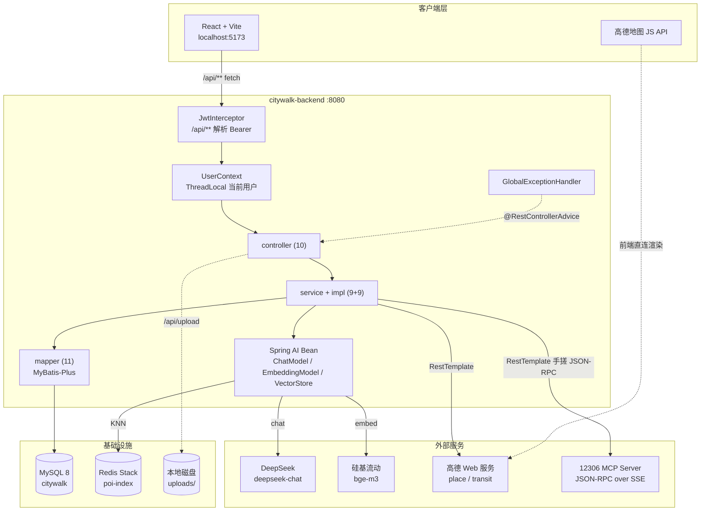
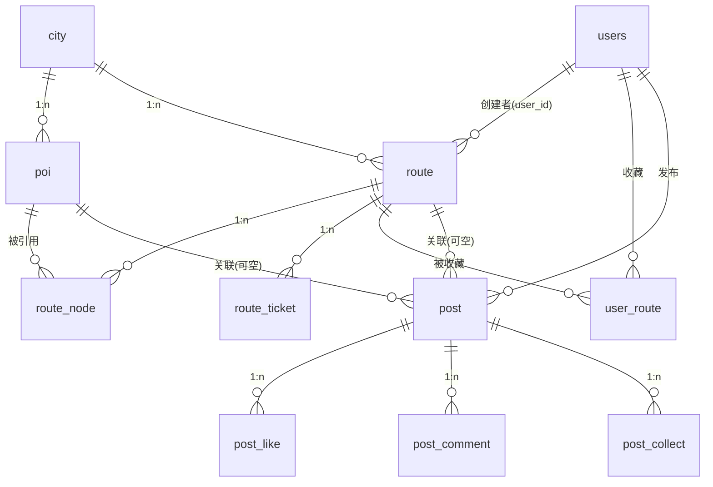

# Citywalk 后端架构深度解析

> **本文与 [`architecture.md`](architecture.md) 的关系**
> `architecture.md` 是简版：一张顶层图 + 一张 RAG 时序图，适合对外展示。
> 本文是深度版：目录含义、分层规则与越界点、7 条核心数据流、数据模型、外部依赖边界、技术债清单、接口清单，适合接手维护或做架构评审时通读。
>
> **基准**
> 代码：`citywalk-backend`（Spring Boot 3.3.5 / Java 17）
> 整理日期：2026-11-18
> 覆盖范围：`src/main/java` 全部 75 个类（另有 1 个测试类）、`src/main/resources` 配置与 7 个 Flyway 脚本、`pom.xml`、前端对接点（vite proxy）。

---

## 目录

- [0. 阅读指引](#0-阅读指引)
- [1. 全局概览](#1-全局概览)
- [2. 目录结构](#2-目录结构)
- [3. 分层与依赖规则](#3-分层与依赖规则)
- [4. 核心数据流](#4-核心数据流)
- [5. 数据模型](#5-数据模型)
- [6. 外部依赖与配置](#6-外部依赖与配置)
- [7. 前端对接边界](#7-前端对接边界)
- [8. 架构评价](#8-架构评价)
- [附录 A：接口清单](#附录-a接口清单)
- [附录 B：关键代码位置速查](#附录-b关键代码位置速查)

---

## 0. 阅读指引

| 你想知道 | 看哪节 |
|---|---|
| 这项目到底怎么跑起来的 | [1. 全局概览](#1-全局概览) |
| 某个包/目录是干什么的 | [2. 目录结构](#2-目录结构) |
| 代码为什么这么分层、哪里漏了 | [3. 分层与依赖规则](#3-分层与依赖规则) |
| AI 生成路线具体怎么走 | [4.3 RAG 生成路线](#43-核心链路ai-生成路线rag) |
| 表之间怎么关联 | [5. 数据模型](#5-数据模型) |
| 依赖了哪些外部服务 | [6. 外部依赖与配置](#6-外部依赖与配置) |
| 有哪些坑、该先修什么 | [8. 架构评价](#8-架构评价) |
| 某个接口在哪个类 | [附录 A](#附录-a接口清单) / [附录 B](#附录-b关键代码位置速查) |

下文所有流程图用 **ASCII / Mermaid** 双轨：ASCII 保证任何编辑器可读，Mermaid 用于 GitHub、Hexo 直接渲染。

---

## 1. 全局概览

### 1.1 一句话概括

这是一个**按功能竖切、按三层横分层**的单体 Spring Boot 应用：

- **没有领域模型层，也没有 Repository 抽象**，业务逻辑集中在 `service.impl`，持久化直接用 MyBatis-Plus 的 `BaseMapper` + `LambdaQueryWrapper`；
- **AI 能力不是独立服务**，而是以 Spring AI 的 `ChatModel` / `EmbeddingModel` / `VectorStore` 三种 Bean 直接注入到 Service 与 Controller；
- **对外部世界全部直连**：DeepSeek、硅基流动、高德、12306 MCP Server 都由 `RestTemplate` 或 Spring AI 客户端发出，没有网关、没有统一客户端封装、没有熔断与限流；
- **持久化是"关系库 + 文档字段"混搭**：结构化数据在 MySQL 表里，跨城多天行程这种半结构化数据以 JSON 字符串躺在 `route.trip_data_json` 中。

一句话：**一个页面背后一个 Controller、一个 Service、一个 Mapper 的均匀结构，AI 点状嵌入其中。**

### 1.2 技术栈

| 层 | 选型 | 版本 | 作用 |
|---|---|---|---|
| 运行时 | Java | 17 | `spring-boot-starter-parent` 管理 |
| Web | Spring MVC（`spring-boot-starter-web`） | Boot 3.3.5 | 同步请求 + SSE 流式（MVC 的 ReactiveTypeHandler） |
| 持久层 | MyBatis-Plus | 3.5.7 | `BaseMapper`、`LambdaQueryWrapper`，无 XML |
| 数据库 | MySQL | 8.x | 主数据存储 |
| 迁移 | Flyway（core + mysql） | Boot 管理 | `db/migration/V1~V7` |
| 缓存/向量 | Redis Stack + Jedis | 7.2 / 5.1.0 | RediSearch 向量索引 `poi-index` |
| AI | Spring AI（openai starter + redis store） | 1.0.0-M6 | Chat / Embedding / VectorStore |
| LLM | DeepSeek `deepseek-chat` | — | OpenAI 兼容协议，`base-url` 指向 api.deepseek.com |
| Embedding | 硅基流动 `BAAI/bge-m3` | 1024 维 | 自建 `OpenAiEmbeddingModel` Bean |
| 认证 | jjwt + `spring-security-crypto`（仅 BCrypt） | 0.12.5 | 自定义 `HandlerInterceptor`，**未引入完整 Spring Security** |
| 文档 | Knife4j（OpenAPI 3） | 4.5.0 | `/doc.html` |
| 其他 | Lombok | Boot 管理 | `@RequiredArgsConstructor` 构造器注入为主 |

### 1.3 顶层架构图



---

## 2. 目录结构

### 2.1 目录树（带注解）

```
citywalk-backend/
├── pom.xml                        依赖清单，也是"技术栈说明书"（Spring Boot 3.3.5 父 POM）
├── mvnw / mvnw.cmd                Maven Wrapper，换机器不用装 Maven
├── README.md                      接口清单 + 功能进度 + 踩坑摘要（事实上的入门文档）
├── HELP.md                        Spring Initializr 残留
├── features_anki.tsv              ┐
├── features_cheatsheet.txt        ├─ 开发过程产物（功能矩阵/速查），不参与运行
├── features_summary.csv           ┘
├── uploads/                       图片上传落地目录，不建库、直接放磁盘
├── .mvn/ .idea/ target/           Wrapper 配置 / IDE / 构建产物
├── .git/  .gitignore  .gitattributes
│
├── docs/                          ★ 项目的"记忆体"：把"为什么这么写"沉淀成文档
│   ├── architecture.md            简版架构图（Mermaid）
│   ├── ARCHITECTURE-DEEP.md       ← 本文
│   ├── system-mindmap.md/.pdf     系统思维导图（5 个维度）
│   ├── 01~08-*.md                 环境、Embedding、Redis Stack、RAG 链路×2、高德公交、照片回填、Schema 漂移、面试盘点
│   ├── DEPLOYMENT.md              部署步骤
│   └── *.sql                      database.sql / community.sql / migration-*.sql（Flyway 之前的存量脚本）
│
└── src/
    ├── main/java/com/citywalk/backend/
    │   ├── CitywalkBackendApplication.java   @SpringBootApplication + @MapperScan("...mapper")
    │   ├── controller/    (10)  参数接收 + 调 service + 组装返回
    │   ├── service/        (9)  业务接口（注意：PoiSearchTool 也在这，它不是 service，是 AI 工具）
    │   ├── service/impl/   (9)  业务实现，@Transactional 边界全部在此
    │   ├── mapper/        (11)  纯 BaseMapper 接口，无 XML、无自定义 SQL 文件
    │   ├── entity/        (11)  与表一一对应，驼峰↔下划线自动映射
    │   ├── dto/           (15)  Request 与 VO/Response 混放
    │   ├── config/         (5)  WebMvcConfig / JwtInterceptor / AmapConfig / EmbeddingConfig / Knife4jConfig
    │   ├── util/           (3)  JwtUtil / UserContext / AmapPoiFetcher
    │   └── exception/      (1)  GlobalExceptionHandler
    │
    ├── main/resources/
    │   ├── application.yaml          主配置（DB/Redis/AI/高德/JWT/MCP/上传目录）
    │   ├── application-prod.yaml     生产配置
    │   ├── application.yaml.example  模板（未被实际使用）
    │   └── db/migration/             Flyway：V1 核心表 / V2 社区 / V3 补列 / V4 车次备注 / V5 行程 JSON / V6 POI ID 改 VARCHAR / V7 帖子收藏
    │
    └── test/java/...                 仅 1 个 contextLoads 冒烟测试
```

### 2.2 各 package 职责

| package | 类数 | 职责 | 允许依赖 | 实际额外依赖（越界） |
|---|---|---|---|---|
| `controller` | 10 | HTTP 协议适配、Swagger 注解、组装返回 | `service`、`dto`、`util.UserContext` | `mapper`（PoiController）、Spring AI Bean（RagController）、`ChatModel`（GuideController） |
| `service` | 9 | 业务契约定义 | `dto`、`entity` | 无 |
| `service.impl` | 9 | 业务实现、事务、外部调用编排 | `mapper`、`entity`、`dto`、`util` | 无 |
| `mapper` | 11 | MyBatis-Plus 数据访问 | `entity` | 无 |
| `entity` | 11 | 表映射 | 无 | 无 |
| `dto` | 15 | 入参出参 | 无 | 无（`PoiInfo` 兼作 AI 工具返回值） |
| `config` | 5 | Bean 装配、拦截器、静态资源 | `util` | `RedisVectorStore`（EmbeddingConfig 自定义装配） |
| `util` | 3 | 无状态工具、ThreadLocal 上下文 | `mapper`（AmapPoiFetcher 直接写库） | 该 util 实际承担了"数据采集 service"职责 |
| `exception` | 1 | 全局异常 → HTTP 状态映射 | — | — |

### 2.3 目录决策解读

| 现象 | 含义 / 影响 |
|---|---|
| `mapper` 无 XML、无 `@Select` | 完全押注 Wrapper API → **查询逻辑事实上写在 service（甚至 controller）里**，这是分层唯一的"漏点" |
| `dto` 里 Request 与 VO 混放 | 没有 `vo` / `request` 子包，也没有 `converter` / `assembler`；VO 转换靠 service 里的私有方法（如 `PostServiceImpl.toVos`）手工拼 |
| `entity` 被 Controller 直接返回 | `CityController`、`PoiController`、`RouteController` 多个接口直接吐实体 → **entity 兼任 VO**，表结构变更会直接改变 API 契约 |
| `PoiSearchTool` 放在 `service` | 它是 `@Component` + `@Tool` 注解的 AI 工具类，逻辑上属于"AI 能力"，没有独立的 `tool`/`ai` 包 |
| `docs/` 极重 | 项目是"边生成边排障"长出来的，踩坑文档就是它的设计 rationale 存档 |
| 无 `src/main/resources/mapper/*.xml` | 确认未用 XML 映射；所有 SQL 由 MyBatis-Plus 生成或 `wrapper.last("LIMIT ...")` 拼接 |

---

## 3. 分层与依赖规则

### 3.1 规范链路

```
HTTP 请求
  → DispatcherServlet
  → JwtInterceptor（/api/** 命中放行名单则跳过解析）
  → Controller            ← 只做参数绑定、调 service、包 Map/实体返回
  → Service 接口
  → ServiceImpl           ← 业务规则、事务、编排外部调用
  → Mapper                ← 单表 CRUD + Wrapper 条件
  → MySQL

横切：
  GlobalExceptionHandler  ← IllegalArgumentException→400，RuntimeException→500，Exception→500
  UserContext             ← ThreadLocal，拦截器写入、service 读取、afterCompletion 清理
```

依赖方向是单向的，没有反向依赖，也没有 service 之间的环（`TransitPlanServiceImpl` 选择自己注入三个 Mapper 拼装，而不是复用 `RouteService`，避免了环）。

### 3.2 四类"越界"

| # | 越界 | 位置 | 后果 |
|---|---|---|---|
| 1 | Controller 直接用 Mapper | `PoiController` 注入 `PoiMapper` 写 Wrapper | POI 取数规则没有单一入口 |
| 2 | Controller 直接用 AI Bean | `RagController` 注入 `EmbeddingModel` / `VectorStore` 并对外暴露测试端点 | 运维能力混进业务 API，且被放行免鉴权 |
| 3 | Controller 里写 AI 编排 | `GuideController` 组装 SystemMessage、截断历史、挂工具、拼 SSE | 唯一一个"无 service 层"的完整业务链路 |
| 4 | `util` 承担 service 职责 | `AmapPoiFetcher` 341 行，含去重入库、回填、刷新 | 数据采集逻辑没有 service 契约，无法在别处复用 |

> 这四处越界不算严重，但合起来解释了为什么"加第三个 AI 功能"会开始重复骨架代码：**没有 `ai` 包来收口 AI 相关编排**。

---

## 4. 核心数据流

### 4.1 认证与请求管道

```
POST /api/auth/login  {username, password}
  │
  ▼
AuthController.login(Map body)                 ← 用 Map 接参，无 LoginRequest DTO
  ▼
UserServiceImpl.login
  ├─ userMapper.selectOne(new LambdaQueryWrapper<User>().eq(User::getUsername, username))
  ├─ BCryptPasswordEncoder.matches(raw, password_hash)
  └─ JwtUtil.generateToken(userId, username)   → HS256，subject=userId，expiration=604800000ms(7天)
  ▼
← {userId, username, nickname, avatar, token}


后续每个请求：
  Authorization: Bearer <token>
  │
  ▼
JwtInterceptor.preHandle                       （挂载：WebMvcConfig.addInterceptors）
  ├─ 无 Authorization / 非 Bearer ──► GET ? 放行 : 401 {"error":"未登录"}
  ├─ getUserIdFromToken 返回 null ──► GET ? 放行 : 401 {"error":"token 无效或已过期"}
  └─ 解析成功 ──► UserContext.setUserId(id)
  ▼
Controller → Service：UserContext.getUserId()  ← 拿"当前用户"的唯一方式
  ▼
JwtInterceptor.afterCompletion ──► UserContext.clear()   ← 防线程池串号
```

**鉴权语义（重要）**：拦截器对 `GET` 一律放行（即使带了无效 token）。因此：

- 所有 `GET` 接口实际是**匿名可访问**；
- 需要登录的只有 `POST / PUT / DELETE`（且不在 `WebMvcConfig` 的放行名单里）。

放行名单（`WebMvcConfig.addInterceptors`）：

```
/api/auth/**            注册登录
/api/city/**            城市列表、详情、城市下的路线列表
/api/rag/**             RAG 相关（含 init-poi-vectors、test-embedding）
/api/route/generate     ★ 已不存在的路径（历史残留）
/api/route/draft/optimize
/api/route/*/h5/**      H5 打卡/日记/照片，公开写
/api/poi/**             POI 查询与采集
/api/guide/**           AI 导游（含 SSE）
```

**副作用**：`GET /api/user/routes`、`GET /api/user/my-plans` 匿名访问时 `UserContext.getUserId()` 为 `null`，查询条件退化成 `user_id = null`，**返回空数组而不是 401**。前端表现为"未登录时我的计划是空的"，不报错。

### 4.2 主数据入厂：POI 采集 → 向量化

这两个步骤都是**运维动作**（手工触发），不在用户请求链路上。

```
① 灌数据
GET /api/poi/fetch?cityId=1            （或 &debug=1 只看第一条原始返回）
GET /api/poi/fetch-food?cityId=1       餐饮单独拉
GET /api/poi/backfill-amap-id?cityId=1 回填高德 POI ID（每次最多 20 条）
POST /api/poi/refresh-photos?cityId=1  回填 photos/openHours（每次最多 20 条）
  ▼
AmapPoiFetcher
  ├─ 高德 place/text：adcode=440600（佛山，硬编码），
  │    TYPES      = 110100 风景名胜 / 110200 公园广场
  │    FOOD_TYPES = 050000 餐饮服务
  ├─ 每类之间 Thread.sleep(500) 防限流
  └─ savePois：按 (cityId + name) 去重后 INSERT poi
  ▼
MySQL.poi    ← ★ 全系统主数据，唯一可信来源

② 建向量索引
GET /api/rag/init-poi-vectors
  ▼
PoiVectorServiceImpl.initPoiVectors
  ├─ (RedisVectorStore) afterPropertiesSet() 确保 poi-index 存在（flushdb 后会丢）
  ├─ SELECT * FROM poi
  ├─ 每条 → Document(
  │      text     = "poiId:{id} {name} {category} {address}",
  │      metadata = {poiId, name, cityId}
  │   )
  └─ vectorStore.add(documents)
        ▼
      硅基流动 bge-m3（1024 维）→ Redis Stack poi-index（RediSearch）
```

> **为什么 text 里要塞 `poiId:123`？**
> Spring AI 1.0.0-M6 检索回来的 `document.getMetadata()` 不可靠，作者用"文本前缀 + 正则"兜底。
> 这是整条 RAG 链最脆的一环（详见 `docs/05-RAG链路踩坑记录.md`），也是全项目最重要的架构妥协：
> **向量库被降级为"模糊召回器"，事实判断全部交回 MySQL。**

### 4.3 核心链路：AI 生成路线（RAG）

```
POST /api/rag/generate-route  {cityId, theme, duration, difficulty}
  │
  │  RouteGenerateServiceImpl.generate（无状态、不落库）
  ▼
┌─ 1. cityMapper.selectById(cityId) ─────────────────────► cityName
│
├─ 2. query = "{theme} {difficulty} {duration}小时"        ← 表单字段直接拼成检索句
│
├─ 3. vectorStore.similaritySearch(SearchRequest{query, topK=30})
│        └─► [Spring AI] embed(query) → 硅基流动 → Redis KNN → 30 条 Document
│        （宽召回、**不带城市过滤**，因为 metadata 的 cityId 不可信）
│
├─ 4. 正则 Pattern.compile("poiId:(\\d+)") 从 doc.getText() 抠 ID
│        └─ 抠不到 → 抛 "检索到的文档缺少 poiId 元数据，无法反查 POI"
│
├─ 5. poiMapper.selectBatchIds(poiIds) ──────────────────► 完整 Poi 实体
│
├─ 6. filter(p.cityId == request.cityId).limit(10)         ← 城市过滤放在**回表之后**
│
├─ 7. buildPrompt(cityName, 10 个 POI, 需求)
│        硬约束：只能从给定列表选 3-5 个 / 只返回 JSON / 停留 30-120 分钟 / 总时长对齐
│
├─ 8. ChatClient.builder(chatModel).prompt(prompt).call().content()
│        └─► OpenAI 兼容 → api.deepseek.com（deepseek-chat, temperature 0.7）
│
└─ 9. parseAiResponse
         ├─ 剥掉 LLM 可能包上的 markdown 代码围栏
         ├─ Jackson → RouteGenerateResponse（title + nodes[]）
         └─ 按 poiId 从第 5 步的 Poi 实体**回填 lat/lng**（不信 LLM 编的坐标）
  ▼
← RouteGenerateResponse{
     title,
     nodes:[{order, poiId, poiName, stayDuration, tip, photoSpot, lat, lng}],
     theme, duration, difficulty
   }
```

**设计要点**

1. **召回与校验分离**：向量库只回答"像不像"，MySQL 回答"是不是"（存在性、城市归属、真实坐标）。
2. **LLM 只做排序与编排**，不做事实来源；白名单由 prompt 约束 + 解析时按 `poiId` 匹配回填双重兜底。
3. **结果不持久化**：生成是纯函数式响应；要落库必须前端再调 `/api/route/save-draft`（见 4.4）。
4. **失败面**：向量库为空 → 500；文档无 poiId → 500；LLM 返回非 JSON → 500（统一被 `GlobalExceptionHandler` 转成 500 + `{message}`）。

### 4.4 计划编辑：TSP 优化 + 草稿保存

```
【优化】前端工作台拖拽后点"优化"
POST /api/route/draft/optimize  {nodes:[{poiId, lat, lng}]}    ← 免鉴权
  ▼
RouteServiceImpl.optimizeDraft
  ├─ n <= 1        → 原样返回，距离 0
  ├─ 2 <= n <= 6   → 固定首节点 + 全排列暴力求最短   O((n-1)!) 最多 120 次
  ├─ n > 6         → 贪心最近邻（首节点固定）
  └─ 距离 = Haversine（R=6371km，逐段累加）
  ▼
← {optimizedNodes, originalDistance, optimizedDistance, savedDistance}（距离保留 2 位小数）


【保存】用户点"保存计划"
POST /api/route/save-draft {routeId?, cityId, title, theme, duration, difficulty,
                            nodes[], tickets[], tripDataJson, aiGenerated}   ← 需登录
  ▼
RouteServiceImpl.saveDraft  @Transactional
  ├─ routeId 有值
  │    ├─ 记录存在但 user_id ≠ 当前用户 → 抛 "无权修改该计划"（400）
  │    ├─ 记录不存在（脏 ID）→ 清掉残留 route_node / route_ticket，退化为新建
  │    ├─ update route（title/theme/duration/difficulty/tripDataJson）
  │    └─ 删除旧 nodes / tickets → 按请求**整表替换**重插
  └─ routeId 为空
       └─ INSERT route(status='saved', user_id=当前用户, ai_generated)
  ▼
← {success:true, routeId}
```

**`trip_data_json` 是这条路线上最特殊的东西**：跨城多天结构（`[{type:"city", pois:[...]}]`）由**前端定义**，后端只做透传 + 局部打点：

```
PUT /api/route/{routeId}/h5/poi  {poiId, isCompleted, userNote, userPhoto}
  → RouteServiceImpl.updateH5Poi
     Jackson 读树 → 遍历 city[].pois[] → 命中 poiId 的节点写入
     is_completed / user_note / user_photo → 序列化回字符串 updateById
```

> 代价：这些字段无法用 SQL 查询（除非 MySQL 8 的 JSON 函数），统计只能取出来在内存算（`PostServiceImpl.computeDays` 就是这么数城市节点得出"3天2晚"的）。

### 4.5 AI 导游（SSE 流式 + 工具调用）

```
POST /api/guide/chat  {cityName, cityId, messages:[{role, content}]}
        produces = text/event-stream        ← 免鉴权、无频率限制
  ▼
GuideController.chat
  ├─ SystemMessage（导游人设 + 200 字限制 + 地图操作 JSON 协议）
  ├─ 历史截断：只保留最近 20 条（≈10 轮），跳过空 content
  ├─ 无 UserMessage → 直接推一条 {"type":"text","content":"请输入想问的问题"}
  └─ ChatClient.prompt().tools(poiSearchTool)
                   .toolContext({cityId, foundPois})
                   .stream().content()
       │
       ├─ 模型决定调工具时 ──► PoiSearchTool.searchCityPOI(cityName, keyword, ctx)
       │      ├─ cityId 优先取 toolContext（可信），否则按 cityName 反查 city
       │      ├─ SELECT ... WHERE city_id=? AND (name|category|description LIKE %kw%) LIMIT 10
       │      └─ 结果 addAll 进 ctx.foundPois（供结束后回传前端打点）
       ▼
  SSE 事件：
    {"type":"text","content":"……逐块……"}      ← Flux.map
    {"type":"pois","pois":[…]}                ← 文本流结束后 Flux.defer 追加
    出错 → onErrorResume → {"type":"text","content":"[出错了，请稍后再试]"}

前端：
  ① 渲染文本流
  ② 收到 pois 事件 → 地图打点
  ③ 解析正文里"独立成行"的 {"action":"add_cities"|"add_pois"|"optimize_route"|"query_ticket", ...}
     → 执行地图/行程操作（LLM 输出即指令，属 prompt 工程，不是 function calling）
```

> **线程模型提醒**：`Spring MVC` 控制器返回 `Flux<ServerSentEvent>`，依赖 Spring AI 传递引入的 `spring-webflux`，由 MVC 的 `ReactiveTypeHandler` 适配成 SSE。能工作，但属于"同步栈里跑响应式"，且没有背压调优。

### 4.6 票务：手搓 MCP 协议

```
GET /api/train/query?from=广州&to=西宁&date=2026-11-20
  ▼
TrainServiceImpl（RestTemplate 裸调，未使用 Spring AI 的 MCP 客户端）
  1. POST {mcp.base-url}{mcp.endpoint}    JSON-RPC "initialize"
       Accept: application/json, text/event-stream
       ← 从响应头 mcp-session-id 取会话
  2. POST {mcp.base-url}{mcp.endpoint}    JSON-RPC "tools/call"
       {name:"query-ticket-price",
        arguments:{from_station, to_station, train_date}}
       header: mcp-session-id
       ← 响应体是 SSE（event: message / data: {...}）
  3. 三层解析
       SSE 帧 ──► JSON-RPC 响应 ──► result.content[0].text（内层还是 JSON 字符串）
       ──► 车次数组
       price 取值优先级：二等座 > 硬座 > 商务座 > 一等座 > 无座 > 第一个可用
  ▼
← TrainQueryResponse{from, to, date, count,
                     trains:[{trainNo, trainCode, startTime, arriveTime,
                              duration, trainClassName, prices{席别:价}, price}]}
```

不落库。用户选中车次后，随 `save-draft` 的 `tickets[]` 写入 `route_ticket`。

### 4.7 社区与文件

```
【发帖】
POST /api/upload (multipart)                    ← 需登录
  ├─ 扩展名白名单 jpg/jpeg/png/webp/gif
  ├─ UUID 文件名（去横线）+ 原扩展名
  └─ file.transferTo({citywalk.upload.dir}/xxx.png)
  ← {url:"/uploads/xxx.png"}                    ← 由 WebMvcConfig 静态映射回读

POST /api/post {title, content, images[], poiId?, routeId?}
  → PostServiceImpl.create
     userId 取自 UserContext，images 序列化成 JSON 字符串
  ← {success:true, id}

【读帖】GET /api/post/list?poiId=&page=&size=
  ├─ selectCount（total）+ selectList（ORDER BY id DESC，LIMIT/OFFSET 用 .last() 拼）
  ├─ toVos：批量回表 users / pois / routes（三张表各一次 selectBatchIds，避免逐条回表）
  ├─ tag / days 推导：
  │    有 routeId → "跨城大环线" + 从 trip_data_json 数城市节点算"3天2晚"
  │    有 poiId   → "城市漫游"
  │    都没有     → "游记"
  └─ 每帖额外 4 次 count（like / comment / collect / 当前用户是否已赞）
        ↑ 这里是真的 N+1（10 条帖子 = 40+ 次 SQL）

【互动】点赞/收藏/评论
  like / collect：先 selectCount 判重再 insert（幂等）
      post_like 有 UNIQUE(user_id, post_id) 兜底
      post_collect（V7）在 service 层判重，未捕获 DuplicateKeyException
  unlike / uncollect：直接按 (user_id, post_id) 删
  comment：insert post_comment → 回查 user 拼 CommentVO
```

### 4.8 数据流总览矩阵

| 链路 | 入口 | 是否需登录 | 读/写 | 外部依赖 | 事务 |
|---|---|---|---|---|---|
| 认证 | `POST /api/auth/*` | 否 | 读写 | 无 | 无（单表） |
| 城市/POI 浏览 | `GET /api/city/*`、`/api/poi/*` | 否（GET） | 读 | 无 | 无 |
| POI 采集 | `GET /api/poi/fetch*` | 否 ❗ | 写 | 高德 place | 无 |
| 向量化 | `GET /api/rag/init-poi-vectors` | 否 ❗ | 写 Redis | 硅基流动 | 无 |
| AI 生成路线 | `POST /api/rag/generate-route` | 否 ❗ | 读 | 硅基流动 + Redis + DeepSeek | 无 |
| TSP 优化 | `POST /api/route/draft/optimize` | 否 | 纯计算 | 无 | 无 |
| 保存计划 | `POST /api/route/save-draft` | 是 | 写 | 无 | ✔ |
| 路线详情 | `GET /api/route/{id}` | 否（GET） | 读 | 无 | 无 |
| 公交方案 | `GET /api/route/{id}/transit` | 否（GET） | 读 | 高德 transit | 无 |
| 票务 | `GET /api/train/query` | 否（GET） | 只读 | MCP 12306 | 无 |
| AI 导游 | `POST /api/guide/chat` | 否 ❗ | 读 | DeepSeek + MySQL | 无 |
| 发帖/互动 | `POST /api/post*` | 是 | 写 | 无 | ✔ |
| 上传 | `POST /api/upload` | 是 | 写磁盘 | 无 | 无 |

> ❗ = 免鉴权但具备写操作或消耗付费额度，见 [8.2](#82-技术债清单)。

---

## 5. 数据模型

### 5.1 关系图



```
city ─1───n─ poi ────────────────────┐
 │                                   │ (poi_id)
 └1───n─ route ─1───n─ route_node ───┘
            │
            ├─1───n─ route_ticket        （绑定车次，prices_json 存席别价）
            ├─ user_id → users           （用户私有计划；官方为 NULL）
            └─ trip_data_json            （跨城多天 JSON，非关系结构）

users ─1───n─ user_route ─n───1─ route   （收藏，UNIQUE(user_id, route_id)）
users ─1───n─ post ─n───1─ poi | route   （帖子可挂 POI 或计划）
post  ─1───n─ post_like / post_comment / post_collect
```

### 5.2 表清单

| 表 | 迁移版本 | 关键字段 | 说明 |
|---|---|---|---|
| `city` | V1 | name, region, lat, lng, slogan, intro | 城市主数据 |
| `poi` | V1 | city_id, name, category, lat, lng, photo_score, food_score, history_score, culture_score, description, photo_spot, photos(JSON), restaurant, avoid_tip, amap_id | 景点/餐饮主数据；`description` 是进向量库的叙事文本 |
| `route` | V1 | city_id, title, theme, duration, difficulty, status, is_official, user_id, day_index, trip_id, ai_generated, **trip_data_json**(V5) | 路线/计划；官方与用户计划同表，靠 status + user_id 区分 |
| `route_node` | V1（V6 改 poi_id 类型） | route_id, poi_id(VARCHAR), sort_order, stay_duration, tip, photo_spot | 路线节点，顺序由 sort_order |
| `route_ticket` | V1（V4 加 note） | route_id, train_code, from/to_station, start/arrive_time, travel_date, prices_json, sort_order | 计划绑定的车次 |
| `users` | V1 | username(UNIQUE), password_hash, nickname, avatar, role | BCrypt 存哈希 |
| `user_route` | V1 | user_id, route_id, UNIQUE(user_id, route_id) | 收藏关系 |
| `post` | V2 | user_id, poi_id, route_id, title, content, images(JSON) | 社区帖子 |
| `post_like` | V2 | user_id, post_id, UNIQUE(user_id, post_id) | 点赞 |
| `post_comment` | V2 | user_id, post_id, content | 评论 |
| `post_collect` | V7 | user_id, post_id | 收藏帖子 |

### 5.3 两个特殊字段（需要留意）

**① `route.trip_data_json`（V5 新增）**

- 结构由前端定义：`[{type:"city", cityId, cityName, pois:[{poiId, is_completed, user_note, user_photo}]}]`
- 后端只透传 + 局部改写（`updateH5Poi` 用 Jackson `ObjectNode` 原地写字段）
- 无法建索引、无法 SQL 过滤；跨城天数、行程校验都只能在内存算

**② `route_node.poi_id` 从 BIGINT 变 VARCHAR（V6）**

- 原因：H5 端可能传非数字 ID，改类型换取兼容
- 影响：`updateH5Poi` 里必须 `String.valueOf(poiId)` 比较，实体到 VO 的转换也要注意类型
- 关联查询时若 poi_id 混入非数字值，`poiMapper.selectById` 会失败（当前代码里 `getDetail` 未做防御）

**双事实来源**：`route.status='official'` 与 `route.is_official` 并存，而 `listByCity` 只按 `status='official'` 过滤 —— 写入时若只设置 `is_official=1`，官方路线不会出现在列表里。

---

## 6. 外部依赖与配置

### 6.1 依赖表

| 依赖 | 客户端 | 用途 | 配置项 | 失败表现 |
|---|---|---|---|---|
| MySQL 8 | MyBatis-Plus / Flyway | 主数据 | `spring.datasource.*` | 启动失败（Flyway 先跑） |
| Redis Stack | Spring AI `RedisVectorStore` + Jedis | 向量检索 | `spring.ai.vectorstore.redis.*`（实际代码里硬编码 `localhost:6379 db0`） | `/generate-route` 500 |
| DeepSeek | Spring AI `ChatModel`（OpenAI 兼容） | 生成路线、导游 | `spring.ai.openai.api-key/base-url/chat.options.model` | 生成 500；导游 SSE 推错误文案 |
| 硅基流动 | 自建 `OpenAiEmbeddingModel` Bean | Embedding（bge-m3，1024 维） | `citywalk.embedding.*` | 向量化/检索 500 |
| 高德 Web 服务 | `RestTemplate` | ① POI 采集 ② 公交路径规划 | `amap.key`、`amap.base-url` | 采集跳过该类别；transit 单段失败仅日志 |
| 12306 MCP Server | `RestTemplate` + 手写 JSON-RPC | 车次/票价 | `citywalk.mcp.base-url/endpoint` | 500 "票价查询失败" |
| 本地磁盘 | `MultipartFile.transferTo` | 图片 | `citywalk.upload.dir` | 上传 500 |

### 6.2 关键配置（`application.yaml`）

```yaml
server.port: 8080

spring.datasource.*              # MySQL，url 带 serverTimezone=Asia/Shanghai
spring.flyway.*                  # baseline-on-migrate, clean-disabled
spring.data.redis.*              # 声明了，但 EmbeddingConfig 未使用（硬编码 localhost）
spring.ai.openai.*               # DeepSeek：api-key / base-url / chat.options.model
spring.ai.vectorstore.redis.*    # uri / index=poi-index / prefix=poi: / initialize-schema
mybatis-plus.configuration.*     # map-underscore-to-camel-case, StdOutImpl SQL 日志
amap.key / amap.base-url
knife4j.enable / setting.language
citywalk.embedding.*             # api-key / base-url / model / dimensions=1024
citywalk.jwt.secret / expiration
citywalk.mcp.base-url / endpoint
citywalk.upload.dir
```

**安全提示**：上述 `api-key`、`amap.key`、`jwt.secret`、数据库密码目前**明文写在本地 `application.yaml`**。好消息是该文件已被 `.gitignore` 排除（`git ls-files` 确认未被跟踪），所以没有随代码入库；但它仍以明文形式存在于工作目录、IDE 索引、构建产物与截图风险面里。`application.yaml.example` 目前未被实际使用，建议改为"模板 + 环境变量"的方式，并轮换已在本机多处出现过的密钥。

### 6.3 超时/重试现状

| 调用点 | 超时 | 重试 | 限流 |
|---|---|---|---|
| `AmapPoiFetcher`（`new RestTemplate()`） | 无 | 无 | `Thread.sleep(500)` 类间 |
| `TransitPlanServiceImpl`（`new RestTemplate()`） | 无 | 无 | `Thread.sleep(200)` 段间 |
| `TrainServiceImpl`（`new RestTemplate()`） | 无 | 无 | 无（每次查询都完整 initialize） |
| Spring AI Chat/Embedding | 框架默认 | `spring-ai-retry` 提供基础重试 | 无 |

> 外部服务一慢，Tomcat 线程就被拖住 —— 这正是 README 待办里"Redis 两级缓存（12306 车次 + 余票）"和"AI 接口限流（Redis 令牌桶）"的真实动机。

---

## 7. 前端对接边界

`citywalk-frontend`（React + Vite）：

```
src/
├── pages/        页面
├── components/   组件（3D 地球、地图、拖拽等）
├── context/      全局状态
├── store/        状态存储
└── data/         静态数据
```

| 边界 | 约定 |
|---|---|
| API 前缀 | 统一 `/api/**`，**无集中式 api client**，页面内直接 `fetch` |
| 开发代理 | `vite.config.js`：`/api` → `http://localhost:8080`，`/uploads` → `http://127.0.0.1:8080` |
| 认证 | 登录后把 token 放 `Authorization: Bearer`，由前端自行注入 |
| 图片 | 上传返回相对路径 `/uploads/xxx`，经代理/反代回读 |
| SSE | `/api/guide/chat` 用 `EventSource` / `fetch` 流式读取，消费两类事件：`{"type":"text"}` 与 `{"type":"pois"}` |
| 地图 | 高德 JS API 前端直连（`VITE_AMAP_JS_KEY`），后端只提供坐标 |
| 跨域 | 开发靠 Vite proxy，生产未配置 CORS（同域部署） |

---

## 8. 架构评价

### 8.1 设计优点

1. **依赖方向干净**：`controller → service → mapper` 单向，无反向依赖、无 service 环。
2. **事务边界统一**：`saveDraft`、`deleteRoute`、`create/like/collect` 等带 `@Transactional`，多表写不会写一半。
3. **外部世界收口**：高德、MCP、AI 都在 service/util 内，Controller 基本不碰 HTTP 客户端（`RagController` 是两个例外）。
4. **Flyway 管 schema**：V1–V7 线性演进；对"AI 反复改表"的项目是必要护栏（`docs/07` 记录了 Schema 漂移排障）。
5. **RAG 的防御性设计**：宽召回 + 回表校验 + 坐标回填 + JSON 围栏剥离，把踩过的坑固化成了代码。
6. **读接口做了批量回表**：`PostServiceImpl.toVos` 对 users/pois/routes 各一次 `selectBatchIds`，避免了最朴素的逐条回表。

### 8.2 技术债清单

| # | 问题 | 位置 | 影响 | 建议 |
|---|---|---|---|---|
| 1 | **AI/运维端点裸奔**：`/api/rag/**`、`/api/poi/**`、`/api/guide/**` 免鉴权，其中 `init-poi-vectors` 会全表向量化、`test-embedding` 直连付费 API | `WebMvcConfig` + `RagController` | 线上任何人可触发，等于暴露"花钱按钮" | 这组端点加管理端鉴权（或 `@Profile("dev")` + 内网限制） |
| 2 | **高德公交城市写死**：`city1=0512&city2=0512`（苏州） | `TransitPlanServiceImpl:89` | 非苏州城市（如佛山 440600）交通方案必然错/空，且异常被 catch 后静默跳过 | 从 `route.cityId` 反查 adcode 拼参数 |
| 3 | **N+1 查询**：每帖 4 次 count；`getDetail` 每节点一次 `selectById` | `PostServiceImpl.toVos`、`RouteServiceImpl.getDetail` | 10 条帖子 = 40+ 次 SQL；节点多时详情页变慢 | 用 `GROUP BY` 一次取计数；详情用 `selectBatchIds` 一次取 POI |
| 4 | **MVC 里跑 Reactor**：`GuideController` 返回 `Flux<ServerSentEvent>` | `GuideController` | 线程模型混搭、无背压调优；流式接口无鉴权无限流 | 明确注释依赖关系；加简单限流（按用户/按 IP） |
| 5 | **查询逻辑下沉**：`PoiController` 直接注入 `PoiMapper`；`RagController` 直接注入 `VectorStore` | `PoiController`、`RagController` | 分层被绕过，取数规则无单一入口 | 抽出 `PoiQueryService`、`RagOpsService` |
| 6 | **返回结构不统一**：`Map{success:true}` / 裸实体 / `RuntimeException`→500 混用 | 全项目 | 前端每接口单独判错；业务错误也返回 500 | 引入统一 `ApiResponse<T>` + 错误码；业务异常用专门的 `BizException` |
| 7 | **配置硬编码/明文**：Redis 连接写在 `EmbeddingConfig`；密钥明文写在本地 yaml（已被 `.gitignore` 排除，未入库） | `EmbeddingConfig`、`application.yaml` | 换环境要改代码；本机多处明文留存，仍有泄露面 | 读 `spring.data.redis`；密钥改环境变量并轮换 |
| 8 | **幂等不彻底**：`like/collect/saveRoute` 先查后插，未捕获 `DuplicateKeyException` | `PostServiceImpl`、`RouteServiceImpl` | 并发双击 → 500 而非幂等成功 | 捕获唯一键冲突视为成功 |
| 9 | **GET 全放行导致语义模糊**：`/api/user/my-plans` 匿名返回空数组 | `JwtInterceptor` | 前端无法区分"未登录"与"没有数据" | 需要登录的 GET 单独列入"必须鉴权"名单 |
| 10 | **残留物**：空 `PoiServiceImpl`、`pom.xml` 重复声明的 `spring-security-crypto`/`jjwt-*`、拦截器里已不存在的 `/api/route/generate` 放行项 | — | 误导后来者 | 清理，或标注为历史遗留 |
| 11 | **无缓存、无超时**：所有 `new RestTemplate()` 无超时；12306 每次完整 initialize | `TrainServiceImpl`、`TransitPlanServiceImpl`、`AmapPoiFetcher` | 外部一慢拖死线程 | 统一 `RestTemplate` Bean（超时/重试）+ 缓存 hot path |
| 12 | **双事实来源**：`route.status` 与 `route.is_official` | `route` 表 | 写入方漏设 status 则列表不可见 | 收敛到一个字段，或加 DB 约束 |

### 8.3 演进路线（建议顺序）

**阶段一：止血（1 天内可做）**

1. 给 `/api/rag/**`、`/api/poi/fetch*` 加鉴权或 dev-only 保护（止住"暴露花钱按钮"）。
2. 修 `TransitPlanServiceImpl` 的 `city1/city2` 硬编码。
3. 清理 `pom.xml` 重复依赖、空 `PoiServiceImpl`、失效放行项。

**阶段二：统一横切关注点（3–5 天）**

4. 抽 `ExternalClientConfig`：`RestTemplate`（连接/读超时）、重试、按服务限流，一处配置。
5. 抽 `ApiResponse<T>` + `BizException` + 错误码表，统一 400/401/500 语义。
6. 缓存：12306 查询结果按 (from,to,date) 短 TTL 缓存；transit 按 (fromPoi,toPoi) 缓存。

**阶段三：收敛结构（按需）**

7. 建 `ai` 包：`RouteGenerationService`（现 `RouteGenerateServiceImpl`）、`GuideChatService`（从 `GuideController` 抽出）、`PoiTool`、`EmbeddingAdminService`。
8. 查询下沉：`PoiQueryService`、`RagOpsService`，让 controller 只做协议适配。
9. 消除 N+1：计数用聚合查询，详情用批量查询。
10. 若出现第二个数据源或第二种 AI 编排，再考虑引入领域层 / 端口-适配器（当前规模尚不必）。

---

## 附录 A：接口清单

> 鉴权列：**匿名** = 无需 token；**登录** = 需要 `Authorization: Bearer`。
> 注：拦截器对 GET 一律放行，因此所有 GET 均为匿名，下表如实标注。

### 认证 `/api/auth`

| 方法 | 路径 | 鉴权 | 入口 | 说明 |
|---|---|---|---|---|
| POST | `/api/auth/register` | 匿名 | `AuthController` | 注册并直接返回 token |
| POST | `/api/auth/login` | 匿名 | `AuthController` | 登录，返回 token + 用户信息 |

### 城市 `/api/city`

| 方法 | 路径 | 鉴权 | 入口 | 说明 |
|---|---|---|---|---|
| GET | `/api/city/list` | 匿名 | `CityController` | 城市列表 |
| GET | `/api/city/{id}/overview` | 匿名 | `CityController` | 城市详情 |
| GET | `/api/city/{cityId}/routes` | 匿名 | `RouteController` | 城市官方路线列表（`status='official'`） |

### POI `/api/poi`

| 方法 | 路径 | 鉴权 | 入口 | 说明 |
|---|---|---|---|---|
| GET | `/api/poi/by-city/{cityId}` | 匿名 | `PoiController` | 城市下全部 POI |
| GET | `/api/poi/search?keyword=` | 匿名 | `PoiController` | 按名称搜（发帖关联用） |
| GET | `/api/poi/fetch?cityId=&debug=` | 匿名 ❗ | `PoiController` | 高德采集入库（写操作） |
| GET | `/api/poi/fetch-food?cityId=` | 匿名 ❗ | `PoiController` | 餐饮类采集（写操作） |
| POST | `/api/poi/refresh-photos?cityId=` | 匿名 ❗ | `PoiController` | 回填照片/营业时间 |
| GET | `/api/poi/backfill-amap-id?cityId=` | 匿名 ❗ | `PoiController` | 回填高德 POI ID |

### 路线与计划 `/api/route`、`/api/user`

| 方法 | 路径 | 鉴权 | 入口 | 说明 |
|---|---|---|---|---|
| GET | `/api/route/{id}` | 匿名 | `RouteController` | 路线详情（节点 + 车次） |
| GET | `/api/route/{id}/transit` | 匿名 | `RouteController` | 节点间公交方案（高德，串行 + sleep） |
| POST | `/api/route/{id}/save` | 登录 | `RouteController` | 收藏路线 |
| POST | `/api/route/save-draft` | 登录 | `RouteController` | 保存/更新计划（整表替换） |
| POST | `/api/route/draft/optimize` | 匿名 | `RouteController` | TSP 优化节点顺序 |
| DELETE | `/api/route/{id}` | 登录 | `RouteController` | 删除计划（级联删 node/ticket） |
| DELETE | `/api/route/{routeId}/tickets/{ticketId}` | 登录 | `RouteController` | 删除计划里的车次 |
| PUT | `/api/route/{routeId}/h5/poi` | 匿名 ❗ | `RouteController` | H5 打卡/日记/照片（公开写） |
| GET | `/api/user/routes` | 匿名* | `RouteController` | 我收藏的路线（匿名返回空） |
| GET | `/api/user/my-plans` | 匿名* | `RouteController` | 我的计划（匿名返回空） |
| PUT | `/api/user/profile` | 登录 | `UserController` | 改昵称 |

### AI `/api/rag`、`/api/guide`

| 方法 | 路径 | 鉴权 | 入口 | 说明 |
|---|---|---|---|---|
| POST | `/api/rag/generate-route` | 匿名 ❗ | `RagController` | RAG 生成路线（消耗 DeepSeek + Embedding 额度） |
| GET | `/api/rag/search?query=&topK=` | 匿名 | `RagController` | 向量检索调试 |
| GET | `/api/rag/test-embedding?text=` | 匿名 ❗ | `RagController` | 直连付费 Embedding |
| GET | `/api/rag/init-poi-vectors` | 匿名 ❗ | `RagController` | 全表向量化（写 Redis） |
| POST | `/api/guide/chat` | 匿名 ❗ | `GuideController` | AI 导游，SSE 流式 + POI 工具 |

### 社区 `/api/post`、上传 `/api/upload`

| 方法 | 路径 | 鉴权 | 入口 | 说明 |
|---|---|---|---|---|
| GET | `/api/post/list?poiId=&page=&size=` | 匿名 | `PostController` | 帖子分页（可按 POI 筛） |
| GET | `/api/post/{id}` | 匿名 | `PostController` | 帖子详情 |
| POST | `/api/post` | 登录 | `PostController` | 发帖 |
| POST | `/api/post/{id}/like` | 登录 | `PostController` | 点赞（幂等） |
| DELETE | `/api/post/{id}/like` | 登录 | `PostController` | 取消点赞 |
| POST | `/api/post/{id}/collect` | 登录 | `PostController` | 收藏帖子 |
| DELETE | `/api/post/{id}/collect` | 登录 | `PostController` | 取消收藏 |
| POST | `/api/post/{id}/comment` | 登录 | `PostController` | 评论 |
| GET | `/api/post/{id}/comments` | 匿名 | `PostController` | 评论列表 |
| GET | `/api/post/my-posts` | 匿名* | `PostController` | 我发布的（匿名返回空） |
| GET | `/api/post/my-collects` | 匿名* | `PostController` | 我收藏的帖子（匿名返回空） |
| POST | `/api/upload` | 登录 | `UploadController` | 图片上传，返回 `/uploads/xxx` |

### 票务 `/api/train`

| 方法 | 路径 | 鉴权 | 入口 | 说明 |
|---|---|---|---|---|
| GET | `/api/train/query?from=&to=&date=` | 匿名 | `TrainController` | 12306 票价（经 MCP） |

\* 标注"匿名*"的接口代码里依赖 `UserContext` 取用户，未登录时返回空集合而非 401。

---

## 附录 B：关键代码位置速查

| 想改什么 | 看哪个文件 |
|---|---|
| 启动类、Mapper 扫描 | `CitywalkBackendApplication.java` |
| 拦截路径 / 放行名单 / 静态资源映射 | `config/WebMvcConfig.java` |
| token 校验逻辑、GET 放行策略 | `config/JwtInterceptor.java` |
| JWT 签发与解析 | `util/JwtUtil.java` |
| 当前用户传递 | `util/UserContext.java` |
| Embedding + VectorStore 装配（含硬编码 Redis） | `config/EmbeddingConfig.java` |
| RAG 生成路线全流程 | `service/impl/RouteGenerateServiceImpl.java` |
| 向量化全量重建 | `service/impl/PoiVectorServiceImpl.java` |
| TSP 优化 / 草稿保存 / 详情装配 | `service/impl/RouteServiceImpl.java` |
| 高德公交方案（含 0512 硬编码） | `service/impl/TransitPlanServiceImpl.java` |
| 12306 MCP 三层解析 | `service/impl/TrainServiceImpl.java` |
| AI 导游 SSE + 地图指令协议 | `controller/GuideController.java` |
| AI 工具（查 POI） | `service/PoiSearchTool.java` |
| 社区读写 + N+1 计数 | `service/impl/PostServiceImpl.java` |
| 高德 POI 采集（341 行） | `util/AmapPoiFetcher.java` |
| 全局异常 → HTTP 状态 | `exception/GlobalExceptionHandler.java` |
| 表结构演进 | `resources/db/migration/V1~V7__*.sql` |
| 外部服务密钥与端口 | `resources/application.yaml` |

---

**维护提示**：本文与代码同步的最佳方式不是定期通读，而是改动下列任一位置时顺手更新对应小节 —— 拦截器放行名单（§4.1 / §8.2-1）、外部依赖表（§6.1）、接口清单（附录 A）、Flyway 新增迁移（§5.2）。
